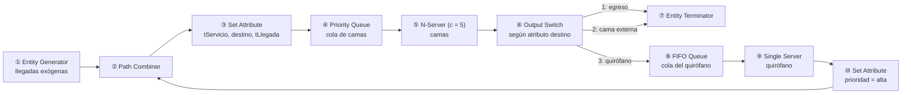

# Esquema de bloques SimEvents

Documento de trabajo para implementar el modelo descrito en [4_simulacion.md](4_simulacion.md). Unidad de tiempo del modelo: **horas**.

> **Importante:** los nombres de bloques y de opciones de este esquema son orientativos y pueden variar según la versión de MATLAB/SimEvents. Los puntos a verificar en el programa están marcados con ⚠️ y reunidos en la sección 6.

## 1. Vista general



Las entidades que retornan del quirófano reingresan por ②, se les sortean de nuevo la duración y el destino en ③ (nueva visita) y compiten en ④ con prioridad alta.

## 2. Entidad y atributos

| Atributo | Tipo | Se asigna en | Para qué |
|:---|:---|:---|:---|
| `tServicio` | double (horas) | ③ | duración de la visita en las camas; la lee ⑤ |
| `destino` | entero 1, 2 o 3 | ③ | 1 = egreso, 2 = cama externa, 3 = quirófano; lo lee ⑥ |
| `prioridad` | entero | ① (exógena = 2) y ⑩ (retorno = 1) | orden en ④ (valor menor = más prioridad) |
| `tLlegada` | double (horas) | ③ | instante de entrada a la cola, para calcular la espera |
| `tServicioQ` | double (horas) | ⑧ o ⑨ | duración en el quirófano; la lee ⑨ |

## 3. Bloques y configuración

| # | Bloque | Configuración | Notas |
|:-:|:---|:---|:---|
| ① | Entity Generator | tiempo entre llegadas $= F^{-1}_{ext}(U)$, con la inversa empírica exógena. Atributo inicial `prioridad = 2` | ⚠️ ver 6.1 |
| ② | Path Combiner | dos entradas (①, ⑩), una salida | une exógenas y retornos |
| ③ | Set Attribute | `tServicio` $= F^{-1}_{S}(U_1)$; `destino` sorteado con $U_2$ y probabilidades $(0,409;\ 0,397;\ 0,194)$; `tLlegada` = reloj de simulación | $U_1$ y $U_2$ independientes |
| ④ | Priority Queue | capacidad infinita; orden por `prioridad` (menor primero); desempate FIFO | ⚠️ ver 6.2 |
| ⑤ | N-Server | capacidad $= 5$; tiempo de servicio tomado del atributo `tServicio` | no hay interrupción de servicio |
| ⑥ | Output Switch | 3 salidas; criterio: según el atributo `destino` | ⚠️ ver 6.3 |
| ⑦ | Entity Terminator | recibe salidas 1 y 2 | cuenta egresos y pases a camas externas |
| ⑧ | FIFO Queue | capacidad infinita | cola del quirófano |
| ⑨ | Single Server | tiempo de servicio $= F^{-1}_{Q}(U_3)$ (inversa empírica del quirófano) | $c = 1$ |
| ⑩ | Set Attribute | `prioridad = 1` | marca el retorno |

**Sorteo de `destino`.** Con $U_2 \sim \text{U}(0,1)$: `destino = 1` si $U_2 < 0,409$; `destino = 2` si $0,409 \le U_2 < 0,806$; `destino = 3` en otro caso.

**Inversa empírica.** Se usan cuatro muestras: servicios de las camas ($n=350$), tiempos entre llegadas exógenas ($n=289$) y servicio del quirófano ($n=65$). Exportarlas desde `datos.db` con el Script SQL 6 y cargarlas en el workspace. Función auxiliar:

```matlab
function invF = crearInversaEmpirica(datos)
    % datos: muestra observada (horas)
    x = sort(datos(:));
    n = numel(x);
    p = ((1:n)' - 0.5) / n;                        % acumuladas empíricas
    invF = @(u) interp1(p, x, min(max(u, p(1)), p(n)), 'linear');
end

% Uso:
invS   = crearInversaEmpirica(servicios);          % camas
invA   = crearInversaEmpirica(llegadasExogenas);   % llegadas exógenas
invQ   = crearInversaEmpirica(servicioQuirofano);  % quirófano

t  = invS(rand);        % una observación
ta = invS(1 - u);       % variable antitética (u es el mismo número usado en t)
```

## 4. Orden de construcción sugerido

Para no depurar todo junto, armar el modelo por etapas y verificar cada una antes de seguir.

1. **Cola M/M/5 de prueba:** ① (exponencial) → ④ sin prioridades → ⑤ → ⑦. Comparar la utilización simulada contra $\rho = \lambda/(c\mu)$. Sirve para aprender el entorno.
2. **Distribuciones empíricas:** reemplazar los tiempos exponenciales por las inversas empíricas. Verificar media y desvío de lo generado.
3. **Atributos y ruteo:** agregar ③ y ⑥ con los tres destinos. Verificar las proporciones de salida $0,409 / 0,397 / 0,194$.
4. **Quirófano y realimentación:** agregar ⑧, ⑨, ⑩ y ②. Pasar el generador a solo exógenas. Verificar que $\lambda_{eff} \approx 0,205$.
5. **Prioridades:** activar el orden por `prioridad` en ④.
6. **Estadísticas y registro:** agregar la medición de la sección 5.

## 5. Medición de las medidas de rendimiento

| Medida | Cómo obtenerla |
|:---|:---|
| $\rho$, $\bar C$ | utilización de ⑤ (promedio temporal); $\bar C = 5\rho$ |
| $L_q$ | longitud media de la cola en ④ |
| $W_q$ | espera media en ④; alternativa: en ⑤, `reloj − tLlegada` por entidad, registrando en `To Workspace` |
| $W_s$ | $W_q + $ media de `tServicio` observada; o registrar `reloj − tLlegada` a la salida de ⑤ |
| $L_s$ | $L_q + \bar C$, o número de entidades en ④ más en ⑤ |
| $P(W_q>0)$ | fracción de entidades con espera $> 0$ (requiere el registro por entidad) |
| $\rho_q$, $L_q^{(q)}$, $W_q^{(q)}$ | utilización de ⑨ y estadísticas de la cola ⑧ |
| Proporciones de ruteo | contador de entidades por cada salida de ⑥ |

Registrar siempre el número de visitas $n$ (para $W_q$ y $W_s$) y el tiempo total simulado $T$. Habilitar las estadísticas desde la pestaña correspondiente de cada bloque. ⚠️ ver 6.4.

## 6. Puntos a verificar en MATLAB

1. **Generador con tiempo entre llegadas aleatorio no estándar.** Confirmar cómo se evalúa una función propia (por ejemplo, `invA(rand)`) en el generador: puede hacerse con la opción de acciones de evento del bloque o con un bloque de MATLAB Function conectado al puerto de tiempo. También hay que fijar la **semilla** de forma controlada (necesario para réplicas independientes y números comunes).
2. **Priority Queue.** Comprobar la convención de la prioridad (si el valor menor o el mayor sale primero) y qué ocurre en empates.
3. **Output Switch por atributo.** Confirmar que admite el criterio "desde atributo" y cómo se numeran los puertos (si comienza en 1).
4. **Nombres de estadísticas.** Qué estadísticas expone cada bloque en su versión (utilización, longitud media, espera media) y si se devuelven como promedio temporal o por entidad.
5. **Reloj de simulación.** Cómo leer el tiempo actual para guardarlo en `tLlegada`.
6. **Arranque y fin de la corrida.** Dónde configurar el tiempo de simulación ($T$) y cómo ejecutar múltiples réplicas en un bucle (`sim` o `parsim`), guardando los resultados de cada una.

## 7. Alternativa si SimEvents se complica

El modelo puede programarse directamente en MATLAB con una lista de eventos (llegada exógena, fin de servicio en camas, fin de servicio en quirófano), manteniendo las mismas distribuciones, ruteo y prioridades. Es más trabajo de código, pero deja control total sobre las semillas, el registro de datos y las técnicas de reducción de varianza. Conviene consultarlo con la docente si SimEvents no permite implementar algún detalle.
