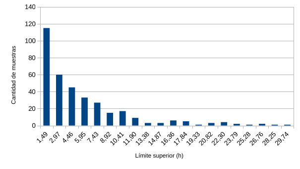
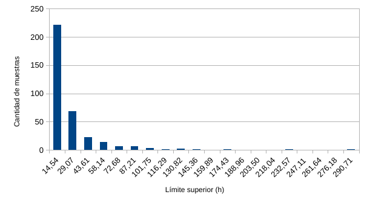

## Distribuciones empíricas

### Tasa de llegadas

|Intervalo|Lím. Sup.|Frecuencia|Frecuencia acumulada|Probabilidad acumulada|
| :---: | :---: | :---: | :---: | :---:
|1 |1,49 |115 |115 |0,324|
|2 |2,97 |60 |175 |0,493|
|3 |4,46 |45 |220 |0,620|
|4 |5,95 |33 |253 |0,713|
|5 |7,43 |27 |280 |0,789|
|6 |8,92 |15 |295 |0,831|
|7 |10,41 |17 |312 |0,879|
|8 |11,90 |9 |321 |0,904|
|9 |13,38 |3 |324 |0,913|
|10 |14,87 |3 |327 |0,921|
|11 |16,36 |6 |333 |0,938|
|12 |17,84 |5 |338 |0,952|
|13 |19,33 |1 |339 |0,955|
|14 |20,82 |3 |342 |0,963|
|15 |22,30 |4 |346 |0,975|
|16 |23,79 |2 |348 |0,980|
|17 |25,28 |1 |349 |0,983|
|18 |26,76 |2 |351 |0,989|
|19 |28,25 |1 |352 |0,992|
|20 |29,74 |2 |355 |1,000|

### Tiempos de servicio

|Intervalo | lím. Sup. | Frecuencia | Frecuencia acumulada | Probabilidad acumulada| 
|:---:|:---:|:---:|:---:|:---:|
|1 | 14,54 | 221 | 221 | 0,623| 
|2 | 29,07 | 69 | 290 | 0,817| 
|3 | 43,61 | 22 | 312 | 0,879| 
|4 | 58,14 | 14 | 326 | 0,918| 
|5 | 72,68 | 7 | 333 | 0,938| 
|6 | 87,21 | 7 | 340 | 0,958| 
|7 | 101,75 | 3 | 343 | 0,966| 
|8 | 116,29 | 1 | 344 | 0,969| 
|9 | 130,82 | 2 | 346 | 0,975| 
|10 | 145,36 | 1 | 347 | 0,977| 
|11 | 159,89 | 0 | 347 | 0,977| 
|12 | 174,43 | 1 | 348 | 0,980| 
|13 | 188,96 | 0 | 348 | 0,980| 
|14 | 203,50 | 0 | 348 | 0,980| 
|15 | 218,04 | 0 | 348 | 0,980| 
|16 | 232,57 | 1 | 349 | 0,983| 
|17 | 247,11 | 0 | 349 | 0,983| 
|18 | 261,64 | 0 | 349 | 0,983| 
|19 | 276,18 | 0 | 349 | 0,983| 
|20 | 290,71 | 1 | 355 | 1,000| 

