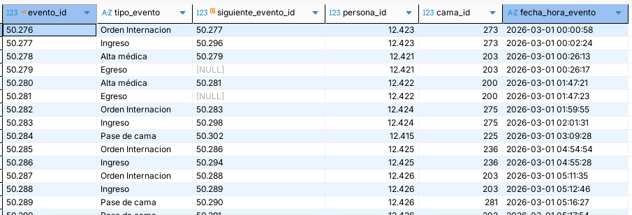
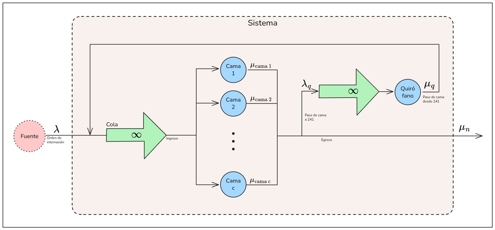
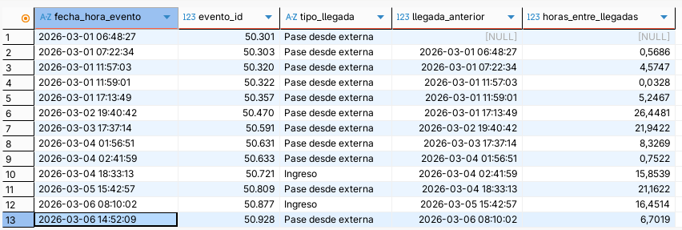
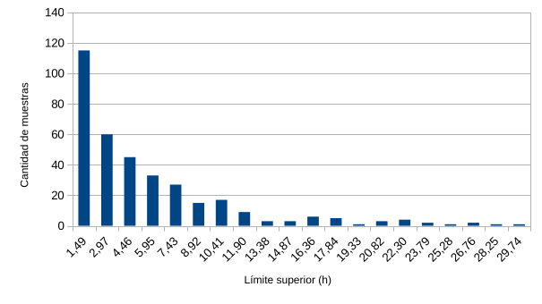
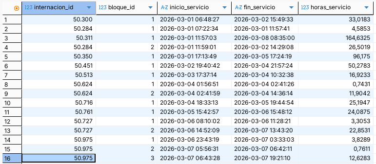
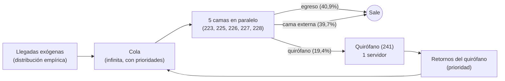
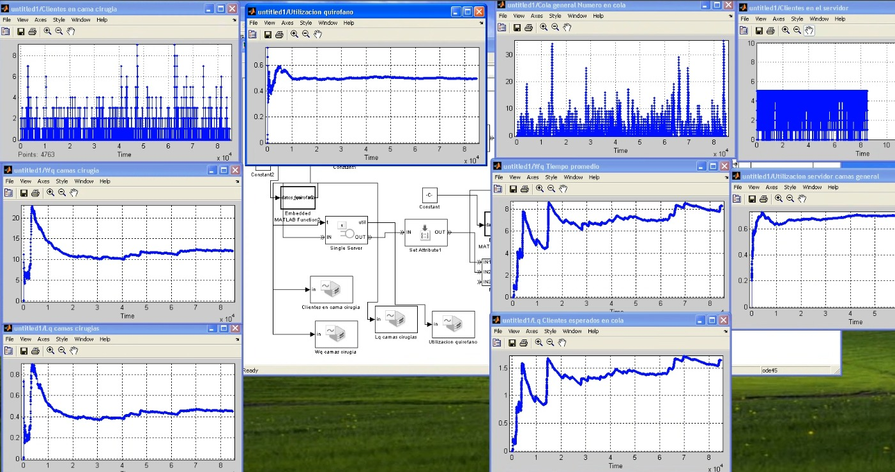
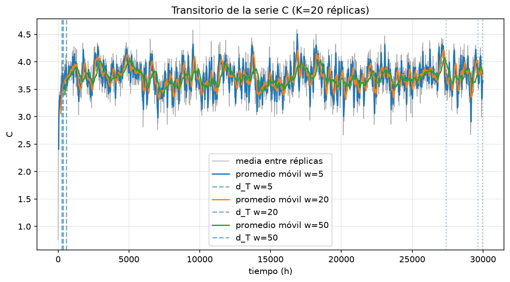
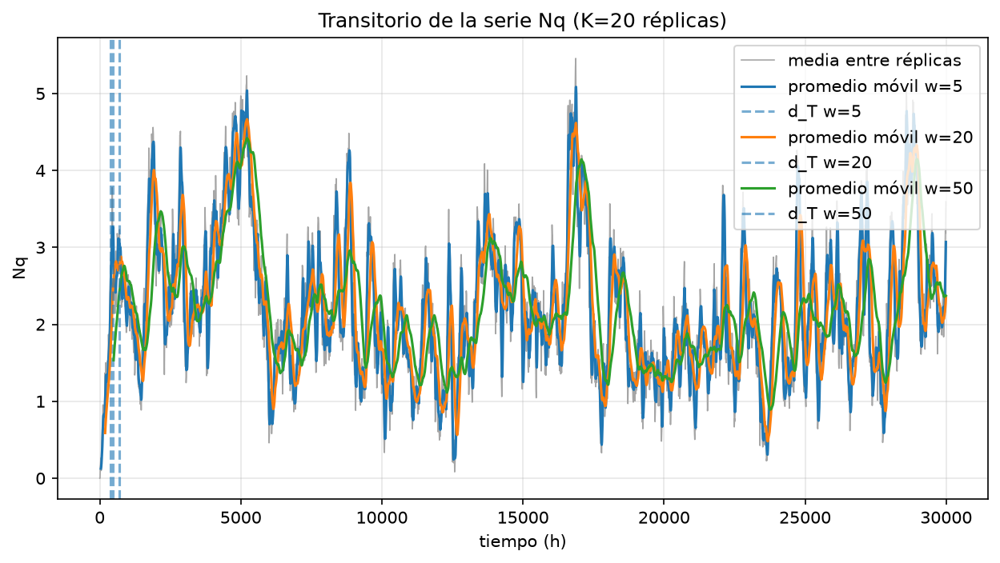

# Simulación: TP Final

Grupo:

- Aita Jerónimo - jeroaitagm@gmail.com
- Mactavish Tomás - tommpack@gmail.com
- Rojas Francis - FranRojas331@gmail.com

Cátedra:

- Universidad Tecnológica Nacional, Facultad Regional Delta
- Simulación 2026
- Docente Franco Lorena - francol.delta.utn@gmail.com

Consigna:

>Seleccionar un sistema a modelar que tenga varios servidores, que estén
conectados en serie y en paralelo (formando una red). Tendrán que contextualizar y explicar su funcionamiento. El sistema considerado debe ser un sistema real del cual puedan demostrar y obtener los datos de las variables exógenas o bien obtener la información a través de alguna fuente pública de internet.
Presentar los datos reales junto con el modelo que describe el funcionamiento del sistema seleccionado (recordar que el sistema seleccionado debe ser con servidores en serie y en paralelo).
>1. Identificar la distribución de generación de transacciones/entidades que ingresan al sistema cómo las relacionadas a los tiempos de atención.
>3. Modelar en el software MATLAB, con la finalidad de obtener parámetros de rendimiento como la utilización de los servidores.
>4. Aplicar un método para reunir observaciones visto en la cátedra y justificando la elección.
>5. Aplicar alguno de los métodos para eliminar el transitorio presentados en la bibliografía y justificar su elección.
>6. Consensuar con el docente las medidas de rendimiento mínimas a obtener.
>7. Se deben determinar el número de simulaciones y las cantidades de observaciones de acuerdo con los casos vistos en la clase.
>8. Sobre las medidas de rendimiento obtenidas construir intervalos de confianza y/o Test de hipótesis según corresponda.
>9. Aplicar un método de reducción de Varianza visto en la cátedra. >10. Escribir conclusiones sobre las medidas de rendimiento del modelo actual y plantear un modelo que el grupo considere que mejorará el original. Se deberá plantear un modelo
diferente al planteado originalmente.
>11. Comparar las medidas de rendimiento obtenidas con el modelo original y escribir conclusiones finales.

## Introducción

### Sistema

Nuestro equipo propone trabajar sobre **la internación de pacientes en un hospital**. Elegimos esta temática porque uno de los integrantes del grupo posee acceso a un sistema de software actualmente utilizado en centros de salud, con el cual se gestionan los movimientos de internación.  Esto nos permite trabajar a partir de un proceso ya sistematizado, y obtener datos reales del uso del sistema.

Para asegurar la protección de información personal, la extracción de datos se realizó limitándose a datos impersonales que son almacenados en el sistema (fechas, horas, ID's numéricos de registros, cadenas de caracteres entre un conjunto pre-definido).

Bajo el contexto de un centro de salud que presta servicio de hospitalización, las instalaciones poseen un determinado conjunto finito de **camas**.

Cuando un médico considera que un paciente requiere hospitalización, genera una **orden de internación** para ese paciente. Esto habilita al personal de enfermería para asignarlo a una cama entre las disponibles. De no haber camas disponibles, el paciente retendría la orden de internación hasta que sea liberada una cama.

Los pacientes ocupan la cama a la que fueron asignados por un cierto periodo de tiempo, pudiendo ser horas o días. También pueden ocurrir **pases de cama**, en caso de ser necesario trasladar al paciente de una habitación a otra.

Luego de cierto tiempo, el médico responsable emite un **alta**, que habilita al personal de enfermería registrar el **egreso** del paciente, dejando libre la cama que ocupaba.

Además, según el cuadro clínico del paciente, el médico puede indicar la necesidad de realizar una operación quirúrgica. La misma requiere pasar al paciente de su cama actual (periodo de preparación pre-quirúrgica) al **quirófano**; una sala especial en la cual el paciente podría pasar entre minutos y horas.

Luego de la operación, el paciente volvería a una cama (periodo de reposo post-quirúrgico) hasta recibir el alta.

### Datos

>Ver el archivo `datos.db`

Tomamos 8.636 registros de base de datos del centro de salud, descartando datos personales y sensibles. Cada registro corresponde a un **evento** que relaciona a un paciente con un tipo de evento, una cama y una fecha-hora. De ocurrir un siguiente evento para el mismo paciente, el sistema actualiza el registro con su ID. Estos datos serán utilizados para la confección del modelo y para la experimentación con simulación de eventos discretos.

Existen los siguientes eventos de tipos:

- Orden Internacion
- Ingreso
- Pase de cama
- Alta médica
- Egreso
- Alta Anulada
- Reingreso
- Cancelacion Internacion

En el contexto de nuestro trabajo, descartaremos los eventos de tipo "Alta médica", "Alta Anulada", "Reingreso" y "Cancelacion Internacion" al ser eventos de tipo administrativo y no representar movimientos de entidades dentro del sistema.

> Script SQL 1: limpieza de datos

De los datos vemos que existen $75$ camas distintas: 75 `cama_id`s distintos, por más que los IDs estén en el orden de los doscientos. Los números de las camas responden a su ubicación dentro del centro de salud: el primer dígito indica el piso dentro de las instalaciones ("200 = segundo piso") y el segundo, la habitación (por ejemplo, "80 = pediatría").

Identificamos que la cama quirófano es aquella con `cama_id = 241` desde el sistema, reafirmado al ver que a esta cama en particular los pacientes llegan únicamente a través de pases de cama.

Un análisis prematuro nos indicaría modelar cada cama como un servidor; $c = 74$ camas regulares en paralelo. Aun así, para el alcance de este trabajo, necesitamos seleccionar un subconjunto de servidores. **Tomaremos únicamente $c = 5$ camas**, seleccionando aquellas con máximo contacto con el quirófano, es decir, mayor cantidad de pases de cama hacia o desde el quirófano.

>Script SQL 2: pases al & desde quirofano

| `cama_id` | # Pases al quirófano| # Pases desde quirófano
| :---: | :---: | :---: |
|223 |18| 23
|226 |13 | 12
|228|13| 14
|225|12| 14
|227|12|14

Desde este subconjunto de camas ocurre el $40\%$ de los pases al quirófano, y a la vez, son el destino del $45\%$ de los retornos del quirófano, siendo que el $60\%$ de las camas poseen 0 pases hacia y desde el quirófano. Las siguientes camas más relacionadas al quirófano son las demás camas con ID entre 220 y 229, de lo que podemos concluir que las mismas corresponden al espacio pre-quirúrgico y post-quirúrgico del hospital. 

Analizaremos el comportamiento de este subconjunto seleccionado de camas a partir de la teoría de colas.

## Análisis

### Modelo

Para analizar este sistema, lo modelamos a partir de la **Teoría de colas** con las siguientes reglas:

- Un paciente es una entidad / cliente.
- Las camas con ID $223$, $225$, $226$, $227$ y $228$ son los $c = 5$ servidores en paralelo. Las consideraremos las camas "internas" o del "sub-sistema seleccionado".
- Entrada: Un evento "Orden de internación" es la llegada de un paciente al sistema. Queda encolado hasta que ocurre el evento "Ingreso", que lo ubica en una de las camas del sub-sistema. También puede ocurrir que se ubique a un paciente en una de estas camas a partir de un evento "Pase de cama" desde una cama regular externa. En ese caso, el tiempo del paciente encolado queda sujeto al tiempo que pasó en camas externas.
- Salida:  Un evento "Egreso" o un "Pase de cama" desde una de las camas del sub-sistema hacia una cama externa es la salida del paciente del sistema.
- Existe una cama especial llamada quirófano, en serie con todas las camas. Se llega al quirófano y se sale del quirófano mediante un evento "Pase de cama". Salir del quirófano implicaría volver a la cola original, pero siempre se retorna a una cama. Por lo tanto, se tiene una cola con prioridades.
- La llegada de un paciente es aleatoria, siguiendo una distribución desconocida.
- El egreso de un paciente es aleatorio, siguiendo una distribución desconocida.

Bajo la notación de Kendall, sería un modelo multi-servidor de cola infinita y fuente infinita: 

$$
(GD|GD|5):(PR|\infty|\infty)
$$

Con este modelo sabemos que:

- La tasa de llegada efectiva es igual a la tasa de llegada, porque la cola es infinita: $\lambda_{eff} = \lambda_n$
- La tasa de llegada no depende del estado del sistema: $\lambda_n = \lambda$
- La tasa de servicio escala con el tiempo de servicio de los servidores y de la cantidad de servidores ocupados: $\mu_n = n \cdot \mu$ (si $n \leq c$) o $\mu_n = c \cdot \mu$ (si $n > c$, todos los servidores ocupados).

Ignoraremos los eventos de tipo "Pase de cama" que ocurran entre las camas del sub-sistema seleccionado, al no representar un cambio en la cantidad de clientes en el sistema. El tiempo de servicio a un paciente se calcularía entonces como la diferencia entre la fecha-hora de egreso, paso a quirófano o paso a cama externa, y la fecha-hora de ingreso o pase a cama interna. Esto se desarrollará con mayor detalle más adelante, cuando analicemos los tiempos de servicio.

Con estas bases definidas, el diagrama de modelo de colas:

### Tasa de llegadas

Filtramos eventos cuyos destinos sean una de las camas seleccionadas, con el objetivo de analizar las llegadas al sistema y comprender el periodo entre ellas.

> Script SQL 3: llegadas

Se registraron $355$ llegadas de pacientes a alguna de las camas del sub-sistema, siendo el $86\%$ pases de cama desde una cama regular externa. Con ello, tenemos $n = 354$ periodos entre las llegadas:

$$
\bar x = \frac{\sum_{i=1}^{n}{ x_i }}{n} \approx 4,95 \frac{\text{horas}}{\text{paciente}}
\ , \qquad
s = \sqrt {\frac{\sum_{i=1}^{n}{ (x_i - \bar x)^2 }}{n-1}} \approx 5,84 \frac{\text{horas}}{\text{paciente}}
$$
Por ende, estimamos la **tasa de llegada** como:

$$
\lambda = \frac{1}{\bar x} \approx 0,2 \frac{\text{pacientes}}{\text{hora}}
$$

Realizamos una **prueba de bondad de ajuste Chi Cuadrado** para comprobar si la distribución se ajusta a una exponencial. Obtuvimos un estimador $\chi^2 \approx 49,21$, mayor al valor crítico tabulado $\chi^2_{0,10, \ 17} \approx 24,77$, por lo que rechazamos la hipótesis nula: los datos no se ajustan a una exponencial.

> Ver apéndice: Análisis de llegadas - Chi Cuadrado

Si bien se rechazó la hipótesis de que las llegadas siguen una distribución exponencial, la media $\lambda = 0,2 \frac{\text{pacientes}}{\text{hora}}$ sigue siendo válida como estimador de la tasa de llegadas, ya que se deriva directamente de la media muestral. Para la simulación, se generarán valores a partir de la distribución empírica.

Como detalle, podemos ver que alrededor del $45\%$ de los periodos entre llegadas son menores a $3$ horas. El histograma:

> Ver Apéndice: Distribuciones empíricas

### Tasas de servicio

Similar al análisis de las llegadas al sistema, analizaremos ahora el tiempo que un paciente permanece en una de las camas seleccionadas; es decir, el tiempo de servicio.

Siguiendo las reglas del modelo, el tiempo de servicio de un paciente es la diferencia entre la fecha-hora de su egreso de su pase de cama al quirófano o una cama externa, y la fecha-hora del evento ingreso o pase de cama con el que llegó a la cama. Se ignoran los pases de cama entre camas dentro del sub-sistema y las altas médicas al no representar un movimiento de entidades dentro del sistema.

> Script SQL 4: tiempos de servicio

Observamos $n=350$ servicios completos, con un tiempo de servicio medio global de $18,1 \frac{\text{ horas }}{\text{ paciente }}$, desvío $29,88$. Esto implicaría una **tasa de servicio del sistema**: 

$$
\mu \approx 0,05  \frac{\text{ pacientes }}{\text{ hora }}
$$

Separando por cama de inicio de servicio,

| Cama | n | Media de horas |  Tasa de servicio |
|:---:|:---:|:---:|:---:|
|223|81|16,88|$\mu_{223} = 0,059$
|226|75|18,01|$\mu_{226} = 0,056$
|228|68|18,63|$\mu_{228} = 0,054$
|225|64|22,23|$\mu_{225} = 0,045$
|227|62|14,78|$\mu_{227} = 0,068$

Por simplicidad, trabajaremos con servidores homogéneos tomando la tasa de servicio del sistema, que es el valor promedio de las tasas de servicios de los servidores.

Además, vemos que el $49\%$ de las internaciones fueron primeras instancias, es decir, primera vez que el paciente circuló por el sub-sistema antes de egresar o pasar de cama. $29\%$ de las internaciones fueron segundas veces que los pacientes circularon por el sub-sistema, como en situaciones en las que retornan del quirófano. $14\%$ fueron terceras instancias, $5\%$ fueron cuartas instancias, $0,2\%$ quintas instancias y hubo una única sexta instancia.

### Llegadas y tiempos de servicio del quirófano

Analizamos ahora el quirófano, la cama $241$, que está en serie con el resto de camas. Consideramos como llegadas los pases de cama dirigidos hacia la $241$ originados desde alguna de las camas del sub-sistema.

> Script SQL 5: Llegadas y tiempos de servicio del quirófano

Tenemos $68$ observaciones, una media de $26,07 \frac{\text{ horas }}{\text{ paciente }}$ y desvío estándar $31,59$.

Calculamos los tiempos de servicio como las diferencias entre los pases de cama originados desde la cama $241$ destinados a alguna cama del sub-sistema, y los pases de cama originados desde una cama del sub-sistema destinados a la cama quirófano.

Tenemos  $65$ observaciones, una media de $1,51 \frac{\text{ horas }}{\text{ paciente }}$ y desvío estándar $2,07$.

Por lo tanto, las tasas de llegada y tiempos de servicio del quirófano:

$$
\lambda_q = 0,04  \frac{\text{ pacientes }}{\text{ hora }}
, \qquad
\mu_q = 0,66  \frac{\text{ pacientes }}{\text{ hora }}
$$

A simple vista vemos que el quirófano posee una utilización baja: $\rho = \lambda / \mu \approx 0,06$.

### Medidas de rendimiento analíticas

El análisis de medidas de rendimiento sólo es válido si el sistema tiende a estado estable. Calculamos el **factor de utilización**:

$$
\rho = \frac{\lambda}{c \cdot \mu} = \approx 0,73
$$

Como $\rho < 1$, el sistema tiende a estado estable. Para el quirófano, $\rho_q = \frac{0,04}{0,66} \approx 0,06$.

El **número esperado de servidores ocupados**, por su fórmula de Little:

$$
\bar C = \frac{\lambda_{eff}}{\mu} = \frac{\lambda}{\mu} \approx 3,66 \ \text{camas}
$$

Si bien trabajamos sobre un modelo G/G/c, las siguientes medidas de rendimiento las calculamos utilizando a partir de la fórmula de probabilidad de $n$ clientes en el sistema del modelo M/M/c como marco de referencia. Las mismas son aproximaciones de referencia; la simulación por software proveerá medidas más fieles al modelo.

Con $a = \lambda / \mu$,
$$
P_0 = \left[ 
\sum_{n=0}^{c-1}{ \frac{a^n}{n!} } + \frac{ a^c }{ c! (1 - \rho) }
\right]^{-1} \approx 0,02
$$

Luego:

$$
P(n \geq c) = \frac{ a^c }{ c! (1 - \rho) } \cdot P_0 \approx 0,43
$$

El **número esperado de clientes en la cola**:

$$
L_q = 0,43 \cdot \frac{\rho}{1-\rho} \approx 1,17 \ \text{pacientes}
$$

El **tiempo esperado de espera en la cola**:

$$
W_q = \frac{L_q}{\lambda} \approx 5,8 \ \text{h}
$$

El **tiempo esperado de espera en el sistema**:

$$
W_s = W_q + \frac{1}{\mu} \approx 23,9 \ \text{h}
$$

El **número esperado de clientes en el sistema**:

$$
L_s = L_q + \frac{\lambda}{\mu} \approx 4,8 \ \text{pacientes}
$$

## Simulación

### Modelo de simulación

Las medidas analíticas de la sección anterior son aproximaciones: asumen servicios y llegadas markovianos, servidores idénticos y llegadas independientes entre sí. El sistema real incumple varios de esos supuestos: las llegadas no son exponenciales, los retornos del quirófano dependen de salidas previas, los tiempos de servicio son muy asimétricos.

La simulación de eventos discretos permite **conservar la estructura del sistema** utilizando una cola con prioridades, un lazo de realimentación por el quirófano, y **usar las distribuciones observadas** sin forzarlas a una forma conocida.

### Mediciones

Una **visita** es cada paso continuo de un paciente por el sub-sistema. El tiempo que el paciente pasa en el quirófano no se cuenta dentro de la visita, pero sí es una parte del ciclo de la realimentación. Sea $T$ la longitud de una corrida, $N_q(t)$ el número de pacientes en cola, $C(t)$ el número de camas ocupadas, $D_i$ la espera de la visita $i$  y $S_i$ el servicio de la visita $i$:

| Medida (medias) | Símbolo | Estimador por corrida |
|:---|:---:|:---|
| Camas ocupadas | $\bar C$ | $\frac{1}{T}\int_{0}^{T}{C(t)} \ dt$ |
| Utilización de las camas | $\rho$ | $\bar C / c \ = \bar C / 5$ |
| Pacientes en cola | $L_q$ | $\frac{1}{T}\int_{0}^{T}{N_q(t)} \ dt$ |
| Pacientes en el sistema | $L_s$ | $\frac{1}{T}\int_{0}^{T}{N_q(t) + C(t)} \ dt$ |
| Espera en cola | $W_q$ | $\frac{1}{n}\sum_{i=1}^{n} D_i$ |
| Tiempo en el sistema | $W_s$ | $\frac{1}{n}\sum_{i=1}^{n} (D_i + S_i)$ |
| Utilización del quirófano | $\rho_q$ | $\%$ de $T$ con el quirófano ocupado |
| Cola y espera en el quirófano | $L_q^{(q)}$, $W_q^{(q)}$ | análogos a $L_q$ y $W_q$ |

Las medidas $\bar C$, $\rho$, $L_s$, $L_q$ y $\rho_q$ son **promedios temporales** (se integran en el tiempo simulado). $W_q$ y $W_s$ son **promedios por observación** (se promedian sobre pacientes). En el planeamiento táctico cada una se tratará con el método de reunión de observaciones correspondiente.

Como control interno, cada corrida debe cumplir la fórmula de Little: $L_s = \lambda_{eff} W_s$ y $L_q = \lambda_{eff} W_q$.

### Distribuciones elegidas

Todas las entradas aleatorias se generan por **transformada inversa de la distribución empírica**. Dado $U \sim \text{U}(0,1)$, se ordena la muestra $x_{(1)} \le \dots \le x_{(n)}$, se asigna a cada $x_{(i)}$ la probabilidad acumulada $p_i = (i - 0,5)/n$ y se interpola linealmente entre puntos consecutivos:

$$
X = F_n^{-1}(U)
$$

Se eligió el método de la inversa porque es válido para cualquier forma y usa un solo número aleatorio por observación, lo que permitirá aplicar variables antitéticas ($U$ y $1-U$) y números aleatorios comunes en las secciones siguientes. La inversa empírica no genera valores fuera del rango observado, lo que es una limitación.

> Script SQL 6: ruteo, llegadas exógenas y ocupación observada

**Llegadas exógenas:** El análisis de llegadas (355 en total) incluye los 65 retornos de pacientes que salieron del sub-sistema hacia el quirófano y volvieron. Si el modelo generara las 355 llegadas y además simulara el lazo por el quirófano, esos retornos se contarían dos veces. Por eso la fuente genera solo las $290$ llegadas exógenas (ingresos directos, pases desde camas externas y retornos del quirófano de pacientes que no provenían del sub-sistema).

| Serie | $n$ | Media (h) | Desvío (h) | $C^2$
|:---|:---:|:---:|:---:|:---:|
| Todas las llegadas | 354 | 4,95 | 5,84 | 1,39 |
| **Llegadas exógenas** | 289 | 6,03 | 6,47 | 1,15 |

La tasa exógena es $\lambda_{ext} \approx 0,166 \frac{\text{pacientes}}{\text{hora}}$. Con el lazo del quirófano, la tasa efectiva de llegadas al sub-sistema resulta del balance de flujo, siendo $p_q$ la probabilidad de pasar al quirófano al terminar un servicio y asumiendo que todos retornan:

$$
\lambda_{eff} = \frac{\lambda_{ext}}{1 - p_q} = \frac{0,166}{1 - 0,194} \approx 0,205 \frac{\text{pacientes}}{\text{hora}}
$$

Que es consistente con la tasa observada sobre las 355 llegadas ($\approx 0,20$).

**Servicio de las camas:** Una única distribución empírica, igual para las 5 camas (servidores homogéneos), construida con los $n = 350$ servicios completos: media $18,07$ h, desvío $29,88$ h, mediana $7,99$ h, máximo $290,7$ h. La distribución es muy asimétrica a la derecha ($C^2 \approx 2,7$), lo cual refuerza la elección de la empírica por sobre una exponencial.

**Destino al terminar el servicio:** Se sortea una categoría con las proporciones observadas en los $350$ servicios:

| Destino | $n$ | Probabilidad |
|:---|:---:|:---:|
| Egreso | 143 | 0,409 |
| Cama externa | 139 | 0,397 |
| Quirófano | 68 | 0,194 |

Se asume que el destino es independiente de la duración del servicio. Es una simplificación, porque en los datos los servicios que terminan en egreso duran en promedio $32,3$ h, contra $7,1$ h (quirófano) y $8,8$ h (cama externa). Preserva la media global del servicio (y por lo tanto $\rho$), pero no la relación entre destino y duración.

**Quirófano:** Un servidor único. Servicio con distribución empírica ($n = 65$): media $1,51$ h, desvío $2,08$ h, mediana $0,06$ h (alrededor de $3,5$ min), máximo $6,9$ h. Asumimos que los pacientes que pasan al quirófano siempre retornan a una cama del sub-sistema (en la muestra, $65$ de $68$).

**Disciplina de cola:** Cola infinita y fuente infinita. Los pacientes que retornan del quirófano tienen prioridad sobre las llegadas nuevas, sin interrupción de servicios en curso. Dentro de cada clase, orden de llegada (FIFO). Un paciente que encuentra camas libres toma una elegida al azar.

### Implementación en MATLAB/SimEvents

El modelo se implementa como una red de bloques de SimEvents con los siguientes elementos:

- **Entidad:** el paciente. Lleva atributos con su duración de servicio, su destino, su prioridad y su instante de llegada a la cola.
- **Fuente:** un generador de entidades con tiempo entre llegadas dado por la inversa empírica exógena.
- **Cola:** una cola con prioridades que alimenta a las camas.
- **Camas:** un servidor múltiple con capacidad $c = 5$, con tiempo de servicio tomado del atributo de la entidad.
- **Ruteo:** un conmutador de salida según el atributo de destino: egreso y cama externa terminan en un sumidero; quirófano deriva a su propia cola y servidor.
- **Realimentación:** la salida del quirófano se reúne con la fuente exógena antes de la cola, con prioridad alta.
- **Medición:** estadísticas de cada bloque (utilización, longitud media de cola, espera media) y registro de tiempos por entidad.

**Limitaciones del modelo**

- Sub-sistema de solo 5 camas; los recorridos por camas externas se consideran exógenos.
- Servidores homogéneos (en los datos, la media por cama varía entre $14,8$ y $22,2$ h).
- Destino independiente de la duración del servicio.
- El quirófano real atiende también a pacientes de otras camas: en los datos, la cama 241 estuvo ocupada alrededor del $30\%$ del tiempo, mientras que el modelo, que solo contempla a pacientes del sub-sistema, da $\rho_q \approx 0,06$. En consecuencia, la espera simulada en el quirófano estará subestimada.
- No se modelan variaciones por hora del día o día de la semana.

## Planeamiento táctico

En esta sección se fijan las decisiones experimentales: tipo de simulación, método para reunir observaciones, transitorio, precisión, número de réplicas y longitud de cada corrida.

### Tipo de simulación

El hospital no tiene un evento de terminación: los pacientes llegan y egresan indefinidamente, y lo que interesa es el comportamiento de largo plazo del sub-sistema. La simulación es **no terminante** y se estudia en **régimen permanente**. Como $\rho \approx 0,73 < 1$, el sistema tiende a estado estable.

Las medidas se calculan de dos maneras:

| Tipo | Medidas | Estimador por corrida |
|:---|:---|:---|
| Promedio temporal | $\bar C$, $\rho$, $L_s$, $L_q$, $\rho_q$, $L_q^{(q)}$ | $\frac{1}{T_c}\int_0^{T_c} X(t)\,dt$ |
| Promedio por observación | $W_q$, $W_s$, $W_q^{(q)}$ | $\frac{1}{n}\sum_{i=1}^{n} X_i$ |

$T_c$ es la ventana de recolección (la corrida sin el transitorio) y $n$ es la cantidad de visitas completas que caen dentro de ella; las visitas en curso al inicio o al final de la ventana se excluyen. Cada corrida produce **una sola observación por medida**.

### Método para reunir observaciones

**Método de réplicas.** Se simulan $M$ corridas independientes, cada una con su propio flujo de números aleatorios, el sistema inicialmente vacío y la misma longitud $T$. De cada corrida se calcula un valor por medida sobre su ventana de recolección, y esos $M$ valores se promedian.

Se eligió este método porque las $M$ observaciones son independientes por construcción, de modo que se puede construir el intervalo de confianza con la distribución $t$ sin suponer nada sobre la dependencia dentro de cada corrida. Además, permite formar los pares necesarios para las variables antitéticas y para los números aleatorios comunes. Se descartó el método de subintervalos (lotes) porque las corridas son instantáneas, de modo que las réplicas no tienen costo adicional y evitan tener que estimar la autocorrelación entre lotes.

### Eliminación del transitorio

**Condiciones iniciales:** sistema vacío (sin cola, con las 5 camas y el quirófano libres). Es la inicialización más simple y es igual en todas las réplicas. Como un hospital real nunca arranca vacío, el período inicial no es representativo y se descarta.

**Método:** promedio móvil de ventana fija (Emshoff y Sisson, descrito en Shannon). Se corren $K = 20$ réplicas piloto de $T = 30.000$ h con la semilla base $12345$. Para cada instante se promedia la medida entre réplicas, $\bar Y_i = \frac{1}{K}\sum_k Y_{k,i}$, y se grafica el promedio móvil de ventana $w$:

$$
\bar Y_j(w) = \frac{1}{w}\sum_{i=j-w+1}^{j} \bar Y_i
$$

El punto en que la curva deja de tener tendencia y oscila alrededor de un nivel define el transitorio. Se aplicó a las medidas $C(t)$ y $N_q(t)$; esta última es la que más tarda en estabilizarse. Se eligió este método porque aprovecha las réplicas piloto que de todos modos hacen falta para calcular $M$, y porque el promedio entre réplicas junto con el promedio móvil suavizan el ruido de una sola corrida, que en este sistema es grande.

**Resultado:** $d_T = 1.000$ h, el mismo valor para todas las réplicas (Shannon recomienda no elegir un descarte distinto por corrida, para no seleccionar corridas favorables). Equivale al $3,3\%$ de la corrida y deja una ventana $T_c = 29.000$ h.

### Precisión y confianza

Se fija $\alpha = 0,10$ (intervalos del $90\%$). La precisión de cada medida $k$ se define relativa a su media:

$$
d_k = p_k \, \bar X_k, \qquad p_k = 10\%
$$

Se usa precisión relativa porque las medidas tienen escalas muy distintas (no es lo mismo exigir media hora de precisión en $W_q$ que en $L_q$). El intervalo con $M$ réplicas es:

$$
\bar X_k \pm t_{\alpha/2;\,M-1}\,\frac{S_k}{\sqrt{M}}, \qquad \text{con semianchura} \le d_k
$$

Excepto para $L_q^{(q)}$ y $W_q^{(q)}$: se usan cotas absolutas ($d = 0,01$ pacientes y $d = 0,05$ h). Con $\rho_q \approx 0,06$ estas medidas son casi cero, y exigirles $10\%$ de una media tan pequeña no tiene sentido práctico.

### Número de corridas y longitud

**Número de réplicas $M$:** Con las $m = 20$ réplicas piloto (con el transitorio descartado) se obtiene el desvío $S_{\bar X}$ de las medias observadas, y se despeja $M$ de la condición de precisión:

$$
M = \left(\frac{t_{\alpha/2;\,m-1}\,S_{\bar X}}{d}\right)^2, \qquad t_{0,05;\,19} \approx 1,73
$$

| Medida | $\bar X$ | $S_{\bar X}$ | $d$ | $M$ |
|:---|:---:|:---:|:---:|:---:|
| $\bar C$ | 3,721 | 0,110 | 0,372 | 1 |
| $\rho$ | 0,744 | 0,022 | 0,074 | 1 |
| $L_s$ | 5,924 | 0,684 | 0,593 | 4 |
| $L_q$ | 2,203 | 0,600 | 0,220 | 23 |
| $W_q$ | 10,722 | 2,928 | 1,072 | 23 |
| $W_s$ | 28,857 | 3,282 | 2,886 | 4 |
| $rho_q$ | 0,060 | 0,003 | 0,006 | 1 |
| $L_q^{(q)}$ | 0,008 | 0,001 | 0,01 (abs.) | 1 |
| $W_q^{(q)}$ | 0,171 | 0,029 | 0,05 (abs.) | 2 |
$L_q^{(q)}$ | 0.008 | 0.001 | 0.01 | 1|
$W_q^{(q)}$ | 0.171 | 0.029 | 0.05 | 2|

Cuando hay varias medidas manda la de mayor variabilidad relativa, así que se adopta **$M = 23$** ($L_q$ y $W_q$). Como $23 > m = 20$, se completan 3 réplicas más con la misma semilla base. El resto de las medidas queda con precisión holgada. Con $p = 10\%$, $M$ depende del coeficiente de variación entre réplicas, $M \approx (t \cdot CV / p)^2$: $L_q$ y $W_q$ tienen $CV \approx 27\%$, mientras que $\bar C$ tiene $3\%$. Esa variabilidad se debe a los servicios de cola pesada ($C^2 \approx 2,7$) y a una utilización alta, que producen congestión persistente.

**Longitud de la corrida:** Se mantiene $T = 30.000$ h, la misma con la que se hizo el piloto, ya que $S_{\bar X}$ y por lo tanto $M$ dependen de $T_c$. Es la misma en todas las réplicas, para que las observaciones sean idénticamente distribuidas. El esfuerzo total es $23 \times 30.000$ h simuladas. Una vez completadas las $M$ réplicas, se verifica que la semianchura de cada intervalo cumpla $\le d_k$; de no ser así, se agregan réplicas.

**Verificación del tamaño de la muestra $n$:** Para las medidas por observación, la desigualdad de Chebyshev da la cantidad mínima de valores por observación sin suponer normalidad:

$$
n = \frac{1}{\alpha\,b^2}, \qquad b = d/\sigma
$$

Con $\alpha = 0,10$ y $b = 1/4$ se obtiene $n = 160$. En $T_c = 29.000$ h hay unas $0,205 \times 29.000 \approx 5.900$ visitas por réplica, muy por encima de ese mínimo. Las esperas de visitas consecutivas están autocorrelacionadas, por lo que $160$ es una cota inferior optimista.

### Resumen de decisiones

| Parámetro | Valor |
|:---|:---|
| Tipo de simulación | no terminante, régimen permanente |
| Método de observaciones | réplicas independientes, semilla base $12345$ con flujos independientes |
| Condiciones iniciales | sistema vacío |
| Transitorio | promedio móvil de ventana fija; $d_T = 1.000$ h en todas las réplicas |
| $\alpha$ | $0,10$ |
| Precisión $d$ | $10\%$ relativo; absoluto en $L_q^{(q)}$ ($0,01$) y $W_q^{(q)}$ ($0,05$ h) |
| Réplicas $M$ | $23$ |
| Longitud $T$ | $30.000$ h ($T_c = 29.000$ h) |

## Resultados y propuesta de optimización

(...)

## Conclusiones

(...)
