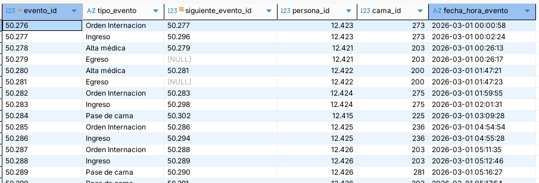

## Introducción

### Sistema

Nuestro equipo propone trabajar sobre **la internación de pacientes en un hospital**. Elegimos esta temática porque uno de los integrantes del grupo posee acceso a un sistema de software actualmente utilizado en centros de salud, con el cual se gestionan los movimientos de internación.  Esto nos permite trabajar a partir de un proceso ya sistematizado, y obtener datos reales del uso del sistema.

Para asegurar la protección de información personal, la extracción de datos se realizó limitándose a datos inpersonales que son almacenados en el sistema (fechas, horas, ID's numéricos de registros, cadenas de caracteres entre un conjunto pre-definido).

Bajo el contexto de un centro de salud que presta servicio de hospitalización, las instalaciones poseen un determinado conjunto finito de **camas**.

Cuando un médico considera que un paciente requiere hospitalización, genera una **orden de internación** para ese paciente. Esto habilita al personal de enfermería para asignarlo a una cama entre las disponibles. De no haber camas disponibles, el paciente retendría la orden de internación hasta que sea liberada una cama.

Los pacientes ocupan la cama a la que fueron asignados por un cierto periodo de tiempo, pudiendo ser horas o días. También pueden ocurrir **pases de cama**, en caso de ser necesario trasladar al paciente de una habitación a otra.

Luego de cierto tiempo, el médico responsable emite un **alta**, que habilita al personal de enfermería registrar el **egreso** del paciente, dejando libre la cama que ocupaba.

Además, según el cuadro clínico del paciente, el médico puede indicar la necesidad de realizar una operación quirúrgica. La misma requiere pasar al paciente de su cama actual (periodo de preparación pre-quirúrgica) al **quirófano**; una sala especial en la cual el paciente podría pasar entre minutos y horas.

Luego de la operación, el paciente volvería a una cama (periodo de reposo post-quirúrgico) hasta recibir el alta.

### Datos

>Ver el archivo `datos.db`

Tomamos 8.636 registros de base de datos del centro de salud, descartando datos personales y sensibles. Cada registro corresponde a un **evento** que relaciona a un paciente con un tipo de evento, una cama y una fecha-hora. De ocurrir un siguiente evento para el mismo paciente, el sistema actualiza el registro con su ID. Estos datos serán utilizados para la confección del modelo y para la experimentación con simulación de eventos discretos.

Existen los siguientes eventos de tipos:

- Orden Internacion
- Ingreso
- Pase de cama
- Alta médica*
- Egreso
- Alta Anulada*
- Reingreso*
- Cancelacion Internacion*

En el contexto de nuestro trabajo, disolveremos los eventos de tipo "Alta médica", "Alta Anulada", "Reingreso" y "Cancelacion Internacion" al ser eventos de tipo administrativo y no representar movimientos de entidades dentro del sistema.

> Script SQL 1: limpieza de datos

De los datos vemos que existen $75$ camas distintas: 75 `cama_id`s distintos, por más que los IDs estén en el orden de los doscientos. Los números de las camas responden a su ubicación dentro del centro de salud: el primer dígito indica el piso dentro de las instalaciones ("200 = segundo piso") y el segundo, la habitación (por ejemplo, "80 = pediatría").

Identificamos que la cama quirófano es aquella con `cama_id = 241` desde el sistema, reafirmado al ver que a esta cama en particular los pacientes llegan únicamente a través de pases de cama.

Un análisis prematuro nos indicaría modelar cada cama como un servidor; $c = 74$ camas regulares en paralelo. Aun así, para el alcance de este trabajo, necesitamos seleccionar un subconjunto de servidores. **Tomaremos únicamente $c = 5$ camas**, seleccionando aquellas con máximo contacto con el quirófano, es decir, mayor cantidad de pases de cama hacia o desde el quirófano.

>Script SQL 2: pases al & desde quirofano

| `cama_id` | # Pases al quirófano| # Pases desde quirófano
| :---: | :---: | :---: |
|223 |18| 23
|226 |13 | 12
|228|13| 14
|225|12| 14
|227|12|14

Desde este subconjunto de camas ocurre el $40\%$ de los pases al quirófano, y a la vez, son el destino del $45\%$ de los retornos del quirófano, siendo que el $60\%$ de las camas poseen 0 pases hacia y desde el quirófano.. Las siguientes camas más relacionadas al quirófano son las demás camas con ID entre 220 y 229, de lo que podemos concluir que las mismas corresponden al espacio pre-quirúrgico y post-quirúrgico del hospital. 

Analizaremos el comportamiento de este subconjunto seleccionado de camas a partir de la teoría de colas.