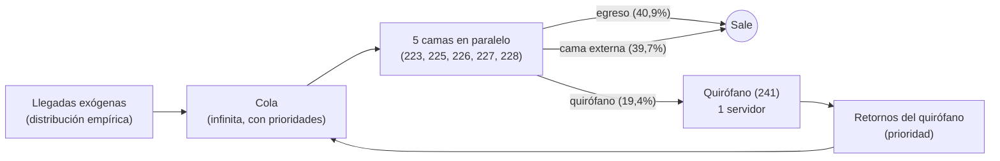
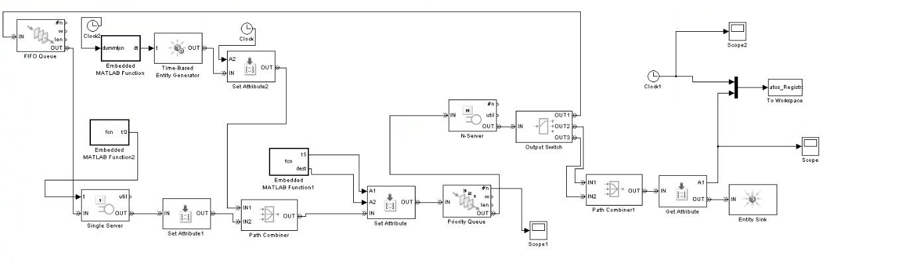

## Simulación

### Modelo de simulación

Las medidas analíticas de la sección anterior son aproximaciones: asumen servicios y llegadas markovianos, servidores idénticos y llegadas independientes entre sí. El sistema real incumple varios de esos supuestos: las llegadas no son exponenciales, los retornos del quirófano dependen de salidas previas, los tiempos de servicio son muy asimétricos.

La simulación de eventos discretos permite **conservar la estructura del sistema** utilizando una cola con prioridades, un lazo de realimentación por el quirófano, y **usar las distribuciones observadas** sin forzarlas a una forma conocida.

### Mediciones

Una **visita** es el paso de un paciente por el sistema. El tiempo que el cliente pasa en el sistema se calcula como la diferencia entre el momento en el que salió (egreso / pase de cama a una externa) y el momento en el que llegó (orden de internación). Así, podemos tomar de cada simulación $n$ visitas y el tiempo que cada una pasó en el sistema. Promediando, obtenemos una medida estimadora de $W_s$.

### Distribuciones y ruteo

Todas las entradas aleatorias se generan por **transformada inversa de la distribución empírica**. Dado $U \sim \text{U}(0,1)$, se ordena la muestra $x_{(1)} \le \dots \le x_{(n)}$, se asigna a cada $x_{(i)}$ la probabilidad acumulada $p_i = (i - 0,5)/n$ y se interpola linealmente entre puntos consecutivos:

$$
X = F_n^{-1}(U)
$$

Se eligió el método de la inversa porque es válido para cualquier forma y usa un solo número aleatorio por observación, lo que permitirá aplicar variables antitéticas ($U$ y $1-U$) y números aleatorios comunes en las secciones siguientes. La inversa empírica no genera valores fuera del rango observado, lo que es una limitación.

> Script SQL 6: ruteo, llegadas exógenas y ocupación observada

**Llegadas exógenas:** El análisis de llegadas (355 en total) incluye los 65 retornos de pacientes que salieron del sub-sistema hacia el quirófano y volvieron. Si el modelo generara las 355 llegadas y además simulara el lazo por el quirófano, esos retornos se contarían dos veces. Por eso la fuente genera solo las $290$ llegadas exógenas (ingresos directos, pases desde camas externas y retornos del quirófano de pacientes que no provenían del sub-sistema).

| Serie | $n$ | Media (h) | Desvío (h) | $C^2$
|:---|:---:|:---:|:---:|:---:|
| Todas las llegadas | 354 | 4,95 | 5,84 | 1,39 |
| **Llegadas exógenas** | 289 | 6,03 | 6,47 | 1,15 |

La tasa exógena es $\lambda_{ext} \approx 0,166 \frac{\text{pacientes}}{\text{hora}}$. Con el lazo del quirófano, la tasa efectiva de llegadas al sub-sistema resulta del balance de flujo, siendo $p_q$ la probabilidad de pasar al quirófano al terminar un servicio y asumiendo que todos retornan:

$$
\lambda_{eff} = \frac{\lambda_{ext}}{1 - p_q} = \frac{0,166}{1 - 0,194} \approx 0,205 \ \frac{\text{pacientes}}{\text{hora}}
$$

Que es consistente con la tasa observada sobre las 355 llegadas ($\approx 0,20$).

**Servicio de las camas:** Una única distribución empírica, igual para las 5 camas (servidores homogéneos), construida con los $n = 350$ servicios completos: media $18,07$ h, desvío $29,88$ h, mediana $7,99$ h, máximo $290,7$ h. La distribución es muy asimétrica a la derecha ($C^2 \approx 2,7$), lo cual refuerza la elección de la empírica por sobre una exponencial.

**Destino al terminar el servicio:** Se sortea una categoría con las proporciones observadas en los $350$ servicios:

| Destino | $n$ | Probabilidad |
|:---|:---:|:---:|
| Egreso | 143 | 0,409 |
| Cama externa | 139 | 0,397 |
| Quirófano | 68 | 0,194 |

Se asume que el destino es independiente de la duración del servicio. Es una simplificación, porque en los datos los servicios que terminan en egreso duran en promedio $32,3$ h, contra $7,1$ h (quirófano) y $8,8$ h (cama externa). Preserva la media global del servicio (y por lo tanto $\rho$), pero no la relación entre destino y duración.

**Quirófano:** Un servidor único. Servicio con distribución empírica ($n = 65$): media $1,51$ h, desvío $2,08$ h, mediana $0,06$ h (alrededor de $3,5$ min), máximo $6,9$ h. Asumimos que los pacientes que pasan al quirófano siempre retornan a una cama del sub-sistema (en la muestra, $65$ de $68$).

**Disciplina de cola:** Cola infinita y fuente infinita. Los pacientes que retornan del quirófano tienen prioridad sobre las llegadas nuevas, sin interrupción de servicios en curso. Dentro de cada clase, orden de llegada (FIFO). Un paciente que encuentra camas libres toma una elegida al azar.

### Implementación en MATLAB/SimEvents

El modelo se implementa como una red de bloques de SimEvents con los siguientes elementos:

- **Entidad:** el paciente. Lleva atributos con su duración de servicio, su destino, su prioridad y su instante de llegada a la cola.
- **Fuente:** un generador de entidades con tiempo entre llegadas dado por la inversa empírica exógena.
- **Cola:** una cola con prioridades que alimenta a las camas.
- **Camas:** un servidor múltiple con capacidad $c = 5$, con tiempo de servicio tomado del atributo de la entidad.
- **Ruteo:** un conmutador de salida según el atributo de destino: egreso y cama externa terminan en un sumidero; quirófano deriva a su propia cola y servidor.
- **Realimentación:** la salida del quirófano se reúne con la fuente exógena antes de la cola, con prioridad alta.
- **Medición:** estadísticas de cada bloque (utilización, longitud media de cola, espera media) y registro de tiempos por entidad.

**Limitaciones del modelo**

- Sub-sistema de solo 5 camas; los recorridos por camas externas se consideran exógenos.
- Servidores homogéneos.
- Destino independiente de la duración del servicio.
- El quirófano real atiende también a pacientes de otras camas: en los datos, la cama 241 estuvo ocupada alrededor del $30\%$ del tiempo, mientras que el modelo, que solo contempla a pacientes del sub-sistema, da $\rho_q \approx 0,06$. En consecuencia, la espera simulada en el quirófano estará subestimada.
- No se modelan variaciones por hora del día o día de la semana.