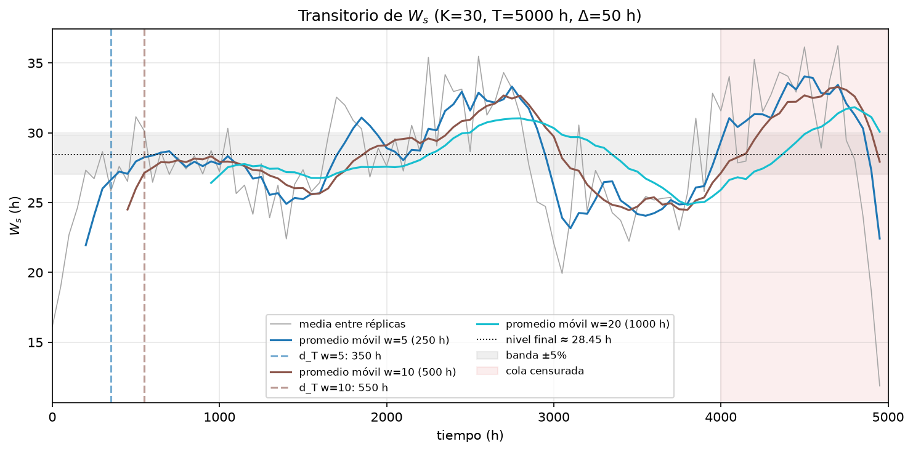

## Planeamiento táctico

En esta sección se fijan las decisiones experimentales: tipo de simulación, método para reunir observaciones, transitorio, precisión, número de réplicas y longitud de cada corrida.

### Tipo de simulación

El hospital no tiene un evento de terminación: los pacientes llegan y egresan indefinidamente, y lo que interesa es el comportamiento de largo plazo del sub-sistema. La simulación es **no terminante** y se estudia en **régimen permanente**.

$T_c$ es la ventana de recolección (la corrida sin el transitorio) y $n$ la cantidad de visitas completas ocurridas dentro de ella; las visitas en curso al final de la ventana se excluyen. Cada corrida producirá una observación de la medida a analizar, ${W_s}_k$, que es una variable basada en promedio por observación:

$$
{W_s}_k = \frac{ \sum_{i=1}^{n}{{W_s}_i} }{ n }
$$

Utilizando el Teorema del Límite Central, sabemos que al ser una distribución de promedios, están normalmente distribuídos. Si obtenemos $M$ observaciones y las promediamos, obtenemos un estimador del valor esperado de $W_s$:

$$
\bar W_s = \frac{ \sum_{k=1}^{M}{{W_s}_k} }{ M }
$$

### Método para reunir observaciones

**Método de réplicas:** Se simulan $M$ corridas independientes, cada una con su propio flujo de números aleatorios, el sistema inicialmente vacío y la misma longitud $T$. De cada corrida se calcula un valor por medida sobre su ventana de recolección, y esos $M$ valores se promedian.

Se eligió este método porque las $M$ observaciones son independientes por construcción, de modo que se puede construir el intervalo de confianza con la distribución $t$ sin suponer nada sobre la dependencia dentro de cada corrida. Además, permite formar los pares necesarios para las variables antitéticas y para los números aleatorios comunes.

### Cantidad de visitas y ventana de tiempo

**Cantidad de visitas $n$:** Para las medidas por observación, la desigualdad de Chebyshev da la cantidad mínima de valores por observación sin suponer normalidad:

$$
n = \frac{1}{\alpha\,b^2}, \qquad b = d/\sigma
$$

Con $\alpha = 0,10$ y $b = 1/4$ se obtiene $n = 160$.

A partir de la tasa de llegada, tenemos que $\lambda \cdot T_c \approx n \Rightarrow T_c \approx \frac{n}{\lambda} = \frac{160}{0,205} = 780,5 \ h$ es el tiempo mínimo teórico para la llegada de la cantidad de visitas necesarias, pero conviene tomar una ventana mayor para asegurarlo. Tomaremos $T_c = 1000\ h$.

Para calcular la longitud total de las corridas, debemos considerar el tiempo que el sistema pasa en estado transitorio.

### Eliminación del transitorio

**Método:** promedio móvil de ventana fija (Emshoff y Sisson, descrito en Shannon). Se corren $k = 30$ réplicas piloto de $T = 5.000$ h con misma semilla base y el sistema inicialmente vacío.

Las visitas se agrupan en intervalos de $\Delta = 50$ h según su instante de llegada (no según su instante de salida, para no favorecer a las visitas cortas al comienzo). Para cada réplica $k$ e intervalo $i$ se calcula

$$
Y_{k,i} = \frac{1}{n_{k,i}}\sum_{v \in i} W_{s,v},
$$

donde $n_{k,i}$ es la cantidad de visitas de la réplica $k$ que llegan en el intervalo $i$ y terminan antes de $T$. Luego se promedia entre réplicas, $\bar Y_i = \frac{1}{K}\sum_k Y_{k,i}$, y se aplica el promedio móvil de ventana $w$:

$$
\bar Y_j(w) = \frac{1}{w}\sum_{i=j-w+1}^{j} \bar Y_i
$$

Se probaron ventanas de $w = 5$, $10$ y $20$ intervalos (250, 500 y 1.000 h). El nivel final se estima en la región central de la corrida, descartando la cola censurada (los últimos 1.000 h), para que las visitas incompletas no sesguen la banda. El punto en que la curva deja de tener tendencia y oscila alrededor de ese nivel define el transitorio.

Las ventanas de 250 y 500 h entran en la banda de $\pm 5\%$ luego de las $350$ h y $550$ h respectivamente. La ventana de 1.000 h, que es la más conservadora y la que mejor filtra las fluctuaciones de largo plazo, entra a las $1.050$ h. 

Consideraremos el periodo transitorio $d_T = 1000 \ h$.

**La longitud total de las corridas** será $T = T_c + d_T = 2000\ h$.

### Número de corridas y longitud total

A partir de las réplicas piloto con el transitorio descartado, se obtiene la media $\bar W_s = 28,98$ con desvío $S_{\bar W_s} = 8,48$. Habiendo tomado $b= d / \sigma = 1 /4$, tenemos que $d= 2,12$. Luego,

$$
M = \left(\frac{t_{\alpha/2; \ k-1} \cdot S_{\bar W_s}}{d}\right)^2, \qquad t_{0,05;\,29} = 1,699
$$
$$
M = \left( \frac{1,699 \cdot 8,48}{2,12} \right)^2 \approx 46
$$
