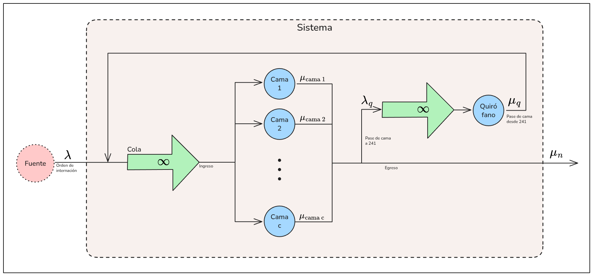
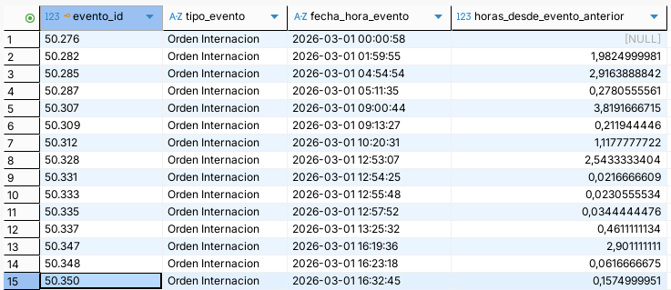

### Modelo

Para analizar este sistema, lo modelamos a partir de la **Teoría de colas** con las siguientes reglas:

- Un paciente es una entidad/cliente.
- El evento "Orden de internación" es la llegada de un paciente al sistema. Queda encolado hasta que ocurre el evento "Ingreso", que lo ubica en una cama.
- Una cama es un servidor.
- Existe una cama especial llamada quirófano, en serie con todas las camas. Se llega al quirófano y se sale del quirófano mediante un evento "Pase de cama". Salir del quirófano implicaría volver a la cola original, pero siempre se retorna a una cama. Por lo tanto, se tiene una cola con prioridades.
- La llegada de un paciente es aleatoria, siguiendo una distribución desconocida.
- El egreso de un paciente es aleatorio, siguiendo una distribución desconocida.

Bajo la notación de Kendall, sería un modelo multi-servidor de cola infinita y fuente infinita: 

$$
(GD|GD|c):(GD|\infty|\infty)
$$

Con este modelo sabemos que:

- La tasa de llegada efectiva es igual a la tasa de llegada, porque la cola es infinita: $\lambda_{eff} = \lambda_n$
- La tasa de llegada no depende del estado del sistema: $\lambda_n = \lambda$
- El tiempo de servicio del sistema escala con el tiempo de servicio de los servidores y de la cantidad de servidores ocupados: $\mu_n = n \cdot \mu$ (si $n \leq c$) o $\mu_n = c \cdot \mu$ (si $n > c$, todos los servidores ocupados). Aun así, contemplaremos que los servidores son heterogéneos; cada uno tendrá su tiempo de servicio.

Retomando de los datos disponibles, podríamos tomar $c = 74$ camas regulares en paralelo. Identificamos que la cama quirófano es aquella con `cama_id = 241` desde el sistema, reafirmado al ver que a esta cama en particular los pacientes llegan únicamente a través de pases de cama.

Aun así, para el alcance de este trabajo, necesitamos acotar la cantidad de servidores. Tomaremos únicamente $c = 5$ camas seleccionadas de manera arbitraria:

- `200`
- `203`
- `225`
- `236`
- `281`

Más la cama quirófano, `241`.

Ignoraremos los eventos de tipo "Pase de cama" que no involucren a la cama `241`, ya que al ser movimientos de entidades entre servidores en paralelo no modifican la cantidad de servidores ocupados. En consecuencia, consideraremos que el paciente continúa en la misma cama desde su ingreso hasta que ocurra un pase de cama al quirófano o hasta su egreso. El tiempo de servicio a un paciente se calcularía entonces como la diferencia entre la fecha-hora de egreso/paso a quirófano y la fecha-hora de ingreso. Esto se desarrollará con mayor detalle más adelante, cuando analicemos los tiempos de servicio.

Además, ignoraremos los eventos de tipo "Alta médica", ya que no implican un movimiento de entidad, sino que representan una etapa burocrática necesaria previa al evento de tipo "Egreso", que sí implica un movimiento de entidad.

Con estas bases definidas, presentamos el diagrama de modelo de colas:

### Tasa de llegadas

Filtramos los eventos de tipo "Orden de internación" con el objetivo de analizar las llegadas al sistema y comprender el periodo entre ellas.

Teniendo $n = 1922$ eventos de tipo Orden de internación, calculamos la media muestral y el desvío estándar:

$$
\bar x = \frac{ \sum_{i=1}^{n}{ x_i } }{n} 
\approx 0,917 \frac{\text{horas}}{\text{paciente}} 
\, \qquad 
s = \sqrt{ \frac{ \sum_{i=1}^{n}{ (x_i - \bar x)^2 } }{n-1} } 
\approx 1,422 \frac{\text{horas}}{\text{paciente}}
$$

Por ende, estimamos la **tasa de llegada** como $\lambda = \frac{1}{\bar x} \approx 1,09 \frac{\text{pacientes}}{\text{hora}}$

Analizamos la distribución a la que se ajustan los periodos entre llegadas. Al ser la variable aleatoria la cantidad de tiempo entre evento y evento, sabemos que es no-negativa. Realizamos una **prueba de bondad de ajuste Chi Cuadrado** para probar si la distribución se ajusta a una exponencial. Utilizamos Chi Cuadrado en lugar de Kolmogorov-Smirnov porque poseemos una gran cantidad de muestras.

Planteamos como hipótesis nula $H_0$ que las muestras corresponden a una distribución exponencial con media $0,917$, y como hipótesis alternativa, que corresponden a otra distribución. Tomamos un nivel de confianza $1 - \alpha = 0,90$.

Tomamos $k = \sqrt{n} \approx  43$ intervalos equiprobables, de frecuencias esperadas $F_e = \frac{n}{k} \approx 44,7$. Calculamos los límites de los intervalos a partir de la inversa de la función de probabilidad acumulada:

$$
\begin{aligned}
&F(x) = 1-e^{- \lambda x} \\
&\Rightarrow F^{-1}(x) = -\frac{1}{\lambda} \cdot \ln \left( 1 - \frac i k \right)\\
&\Rightarrow x_i = -0,917 \cdot \ln \left( 1 - \frac{i}{43} \right)
\end{aligned}
$$

Luego los intervalos: $[x_0; \ x_1) = [0; \ 0,022), \, [x_1; \ x_2) = [0,022; \ 0,044), \, ...$ . Realizamos un conteo de las muestras incluídas en cada intervalo; las frecuencias observadas $F_o$.

Calculamos el estimador:

$$
\chi^2 = \sum{ \frac{(F_o - F_e)^2}{F_e}} \approx 2695,5
$$

Poseemos $k-1-1 = 41$ grados de libertad restamos uno por haber estimado la media a partir de la muestra. Luego el estimador tabulado:

$$
\chi^2_{\alpha, \, k-1-1} = \chi^2_{0,10, \, 41} \approx 52,95
$$

Vemos que el $\chi^2$ calculado es ampliamente superior al $\chi^2$ tabulado, por lo que rechazamos la $H_0$ con un nivel de confianza del 90%; la distribución de entradas no es exponencial.

Detalles a considerar:

- El primer intervalo, $[0; \, 0,022)$ (periodos de menos de 1,3 minutos entre entradas) aporta $\frac{(F_o - F_e)^2}{F_e} = 2455,6$ al estadístico, es decir, casi la totalidad del peso de los resultados.
- Los intervalos intermedios respetan una alineación equilibrada más próxima a la distribución esperada.
- El último intervalo, $[3,449; \ \infty)$ (entradas cada más de 3,5 horas) son el siguiente gran aporte al estadístico.

Esto sugiere que el proceso de llegadas al sistema no es homogéneo, sino que podría ser una mezcla entre:

- Llegadas "reales" de pacientes, espaciadas, más similares a una exponencial.
- Órdenes de internación cargadas en conjunto, casi simultáneamente, quizás por el mismo usuario o al inicio de determinado turno.
- Periodos de más de 3,5 horas sin cargas de internaciones, quizás por caídas del sistema, parálisis administrativa de la institución o demás factores externos.

Si bien se rechazó la hipótesis de que las llegadas siguen una distribución exponencial, la media $\lambda = 1,09 \frac{\text{pacientes}}{\text{hora}}$ sigue siendo válida como estimador de la tasa de llegadas, ya que se deriva directamente de la media muestral. La misma será utilizada como parámetro descriptivo del proceso GD en el modelo de colas.

### Tiempos de servicio

Similiar al procedimiento realizado para analizar las llegadas al sistema, filtramos los eventos de tipo Egreso con el objetivo de analizar los tiempos de servicio de las camas.

