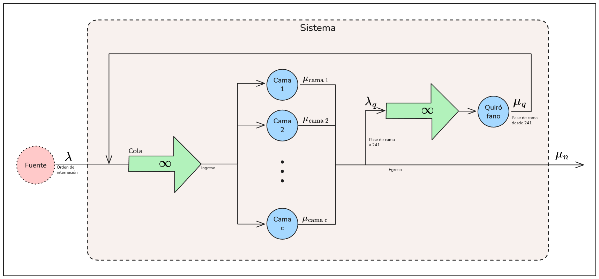
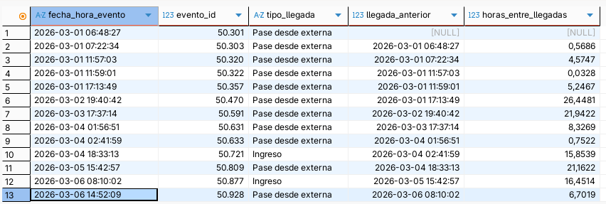
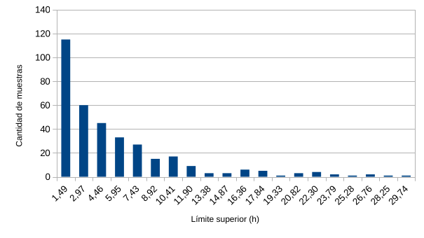
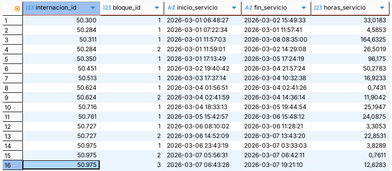

### Modelo

Para analizar este sistema, lo modelamos a partir de la **Teoría de colas** con las siguientes reglas:

- Un paciente es una entidad / cliente.
- Las camas con ID $223$, $225$, $226$, $227$ y $228$ son los $c = 5$ servidores en paralelo. Las consideraremos las camas "internas" o del "sub-sistema seleccionado".
- Entrada: Un evento "Orden de internación" es la llegada de un paciente al sistema. Queda encolado hasta que ocurre el evento "Ingreso", que lo ubica en una de las camas del sub-sistema. También puede ocurrir que se ubique a un paciente en una de estas camas a partir de un evento "Pase de cama" desde una cama regular externa. En ese caso, el tiempo del paciente encolado queda sujeto al tiempo que pasó en camas externas.
- Salida:  Un evento "Egreso" o un "Pase de cama" desde una de las camas del sub-sistema hacia una cama externa es la salida del paciente del sistema.
- Existe una cama especial llamada quirófano, en serie con todas las camas. Se llega al quirófano y se sale del quirófano mediante un evento "Pase de cama". Salir del quirófano implicaría volver a la cola original, pero siempre se retorna a una cama. Por lo tanto, se tiene una cola con prioridades.
- La llegada de un paciente es aleatoria, siguiendo una distribución desconocida.
- El egreso de un paciente es aleatorio, siguiendo una distribución desconocida.

Bajo la notación de Kendall, sería un modelo multi-servidor de cola infinita y fuente infinita: 

$$
(GD|GD|5):(GD|\infty|\infty)
$$

Con este modelo sabemos que:

- La tasa de llegada efectiva es igual a la tasa de llegada, porque la cola es infinita: $\lambda_{eff} = \lambda_n$
- La tasa de llegada no depende del estado del sistema: $\lambda_n = \lambda$
- El tiempo de servicio del sistema escala con el tiempo de servicio de los servidores y de la cantidad de servidores ocupados: $\mu_n = n \cdot \mu$ (si $n \leq c$) o $\mu_n = c \cdot \mu$ (si $n > c$, todos los servidores ocupados). Aun así, contemplaremos que los servidores podrían ser heterogéneos; cada uno con su tiempo de servicio.

Ignoraremos los eventos de tipo "Pase de cama" que ocurran entre las camas del sub-sistema seleccionado, al no representar un cambio en la cantidad de clientes en el sistema. El tiempo de servicio a un paciente se calcularía entonces como la diferencia entre la fecha-hora de egreso, paso a quirófano o paso a cama externa, y la fecha-hora de ingreso o pase a cama interna. Esto se desarrollará con mayor detalle más adelante, cuando analicemos los tiempos de servicio.

Con estas bases definidas, el diagrama de modelo de colas:

### Tasa de llegadas

Filtramos eventos cuyos destinos sean una de las camas seleccionadas, con el objetivo de analizar las llegadas al sistema y comprender el periodo entre ellas.

> Script SQL 3: llegadas

Se registraron $355$ llegadas de pacientes a alguna de las camas del sub-sistema, siendo el $86\%$ pases de cama desde una cama regular externa. Con ello, tenemos $n = 354$ periodos entre las llegadas:

$$
\bar x = \frac{\sum_{i=1}^{n}{ x_i }}{n} \approx 4,95 \frac{\text{horas}}{\text{paciente}}
\ , \qquad
s = \sqrt {\frac{\sum_{i=1}^{n}{ (x_i - \bar x)^2 }}{n-1}} \approx 5,84 \frac{\text{horas}}{\text{paciente}}
$$
Por ende, estimamos la **tasa de llegada** como $\lambda = \frac{1}{\bar x} \approx 0,2 \frac{\text{pacientes}}{\text{hora}}$.

Realizamos una **prueba de bondad de ajuste Chi Cuadrado** para comprobar si la distribución se ajusta a una exponencial. Obtuvimos un estimador $\chi^2 \approx 49,21$, mayor al valor crítico tabulado $\chi^2_{0,10, \ 17} \approx 24,77$, por lo que rechazamos la hipótesis nula: los datos no se ajustan a una exponencial.

> Ver apéndice: Análisis de llegadas - Chi Cuadrado

Si bien se rechazó la hipótesis de que las llegadas siguen una distribución exponencial, la media $\lambda = 0,2 \frac{\text{pacientes}}{\text{hora}}$ sigue siendo válida como estimador de la tasa de llegadas, ya que se deriva directamente de la media muestral. La misma será utilizada como parámetro descriptivo del proceso GD en el modelo de colas.

Como detalle, podemos ver que alrededor del $45\%$ de los periodos entre llegadas son menores a $3$ horas. El histograma:

### Tasas de servicio

Similar al análisis de las llegadas al sistema, analizaremos ahora el tiempo que un paciente permanece en una de las camas seleccionadas; es decir, el tiempo de servicio.

Siguiendo las reglas del modelo, el tiempo de servicio de un paciente es la diferencia entre la fecha-hora de su egreso de su pase de cama al quirófano o una cama externa, y la fecha-hora del evento ingreso o pase de cama con el que llegó a la cama. Se ignoran los pases de cama entre camas dentro del sub-sistema y las altas médicas al no representar un movimiento de entidades dentro del sistema.

> Script SQL 4: tiempos de servicio

Observamos $n=350$ servicios completos, con un tiempo de servicio medio global de $18,1 \frac{\text{ horas }}{\text{ paciente }}$, desvío $29,83$. Esto implicaría una tasa de servicio del sistema de $\mu = 0,06  \frac{\text{ pacientes }}{\text{ hora }}$

Separando por cama de inicio de servicio,

| Cama | n | Media de horas |  Tasa de servicio |
|:---:|:---:|:---:|:---:|
|223|81|16,88|$\mu_{233} = 0,059$
|226|75|18,01|$\mu_{236} = 0,056$
|228|68|18,63|$\mu_{238} = 0,054$
|225|64|22,23|$\mu_{235} = 0,045$
|227|62|14,78|$\mu_{237} = 0,068$

Además, vemos que el $49\%$ de las internaciones fueron primeras instancias, es decir, primera vez que el paciente circuló por el sub-sistema antes de egresar o pasar de cama. $29%$ de las internaciones fueron segundas veces que los pacientes circularon por el sub-sistema, como en situaciones en las que retornan del quirófano. $14\%$ fueron terceras instancias, $5\%$ fueron cuartas instancias, $0,2\%$ quintas instancias y hubo una única sexta instancia.

### Llegadas y tiempos de servicio del quirófano

Analizamos ahora el quirófano, la cama `241`, que está en serie con el resto de camas. Consideramos únicamente a los pacientes cuya internación comenzó en alguna de las 10 camas seleccionadas.

Cada evento "Pase de cama" hacia la cama `241` es una llegada al quirófano. La salida del quirófano es el primer evento posterior a que sea un pase a otra cama o un "Egreso". Poseemos $83$ visitas al quirófano, por lo que $n=82$ periodos entre llegadas. Calculamos la media muestral y el desvío estándar de los periodos entre las llegadas:

$$
\bar x \approx 20,878 \frac{\text{horas}}{\text{paciente}} 
\, \qquad 
s \approx 32,316 \frac{\text{horas}}{\text{paciente}}
$$

Por ende, estimamos la **tasa de llegada al quirófano** como $\lambda_q = \frac{1}{\bar x} \approx 0,048 \frac{\text{pacientes}}{\text{hora}}$.

$83$ de los $1268$ servicios completos (considerando todas las camas, no sólo las seleccionadas) pasan al quirófano, es decir, alrededor del $6,5\%$.

Todas las visitas al quirófano poseen una salida registrada. Analizamos el periodo entre las salidas del quirófano:

$$
\bar x \approx 1,923 \frac{\text{horas}}{\text{paciente}} 
\, \qquad 
s \approx 2,194 \frac{\text{horas}}{\text{paciente}}
$$

Obtenemos que la **tasa de servicio del quirófano** es $\mu_q = \frac{1}{\bar x} \approx 0,520 \frac{\text{pacientes}}{\text{hora}}$.

### Medidas de rendimiento analíticas

(...)

