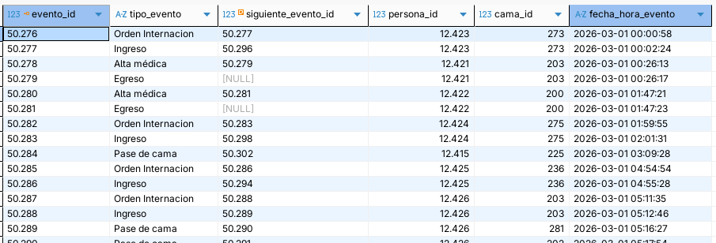

### Sistema

Nuestro equipo propone trabajar sobre **la internación de pacientes en un hospital**. Elegimos esta temática porque uno de los integrantes del grupo posee acceso a un sistema de software actualmente utilizado en centros de salud, con el cual se gestionan los movimientos de internación.  Esto nos permite trabajar a partir de un proceso ya sistematizado, y obtener datos reales del uso del sistema.

Para asegurar la protección de información personal, la extracción de datos se realizó limitándose a datos inpersonales que son almacenados en el sistema (fechas, horas, ID's numéricos de registros, cadenas de caracteres entre un conjunto pre-definido).

Bajo el contexto de un centro de salud que presta servicio de hospitalización, las instalaciones poseen un determinado conjunto finito de **camas**.

Cuando un médico considera que un paciente requiere hospitalización, genera una **orden de internación** para ese paciente. Esto habilita al personal de enfermería para asignarlo a una cama entre las disponibles. De no haber camas disponibles, el paciente retendría la orden de internación hasta que sea liberada una cama.

Los pacientes ocupan la cama a la que fueron asignados por un cierto periodo de tiempo, pudiendo ser horas o días. También pueden ocurrir **pases de cama**, en caso de ser necesario trasladar al paciente de una habitación a otra.

Luego de cierto tiempo, el médico responsable emite un **alta**, que habilita al personal de enfermería registrar el **egreso** del paciente, dejando libre la cama que ocupaba.

Además, según el cuadro clínico del paciente, el médico puede indicar la necesidad de realizar una operación quirúrgica. La misma requiere pasar al paciente de su cama actual (periodo de preparación pre-quirúrgica) al **quirófano**; una sala especial en la cual el paciente podría pasar entre minutos y horas.

Luego de la operación, el paciente volvería a una cama (periodo de reposo post-quirúrgico) hasta recibir el alta.

### Datos

>Ver el archivo `angeles-movimientos_internacion.csv`

Tomamos 9016 registros de base de datos del centro de salud, descartando datos personales y sensibles. Cada registro corresponde a un **evento** que relaciona a un paciente con un tipo de evento, una cama y una fecha-hora. De ocurrir un siguiente evento para el mismo paciente, el sistema actualiza el registro con su ID.

Existen los eventos de tipos:

- Orden de internación
- Ingreso
- Pase de cama
- Alta médica
- Egreso

Aquí vemos que existen $75$ camas distintas: 75 `cama_id`s distintos, por más que los IDs estén en el orden de los doscientos. Los números de las camas podrían corresponderse a su ubicación dentro del centro de salud - por ejemplo, que el primer dígito indique el piso dentro de las instalaciones (200 = "segundo piso") y el segundo, la habitación (80 = "pediatría").

Estos datos serán utilizados para la confección del modelo y para la experimentación con simulación de eventos discretos.
